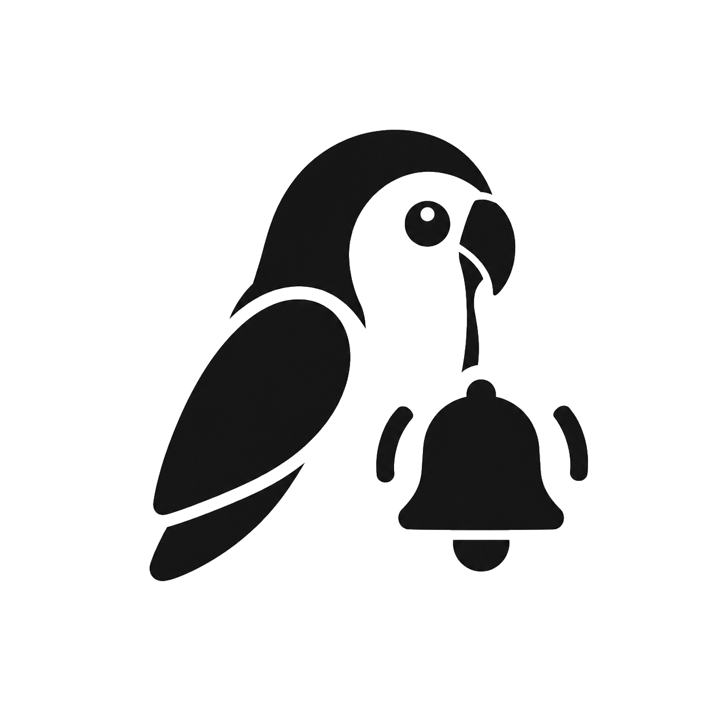

<p align="center">

</p>


<h1 align="center">SimpleMessage</h1>
一个基于插件机制的通知聚合与投递工具。数据由**调度源插件（Source）**采集，
经宿主的调度、路由与队列，交给**UI 插件（Notifier）**呈现或转发。

界面用 imgui 实现，配置用 TOML，日志自实现。


## 快速开始

```sh
git clone <repo> SimpleMesssage
cd SimpleMesssage
cmake -B build                            # 或 -DCMAKE_BUILD_TYPE=Release / -G "Visual Studio 18 2026"
cmake --build build
build/Release/sm_host.exe                 # 常驻托盘
build/Release/sm_host.exe --help          # 全部命令行参数
```

版本号来自最近的 `vX.Y.Z` git tag（`git describe`），不写死在源码里；打新 tag 后
需重新运行一次 cmake 配置。浅克隆或压缩包构建前请先 `git fetch --tags`，否则会退回
`include/sm/version.h` 里的兜底版本并在 CMake 配置时给出警告。


**CMake 选项**

| 选项 | 默认 | 说明 |
|---|---|---|
| `SM_BUILD_HOST` | ON | 构建宿主可执行文件 |
| `SM_BUILD_SAMPLES` | ON | 构建六个示例插件 |
| `SM_BUILD_TEST_PLUGINS` | OFF | 构建 `plugins/_test/` 与 `plugins/_badmeta/` 的 30 个坏插件到 `<build>/<配置>/plugins_test/` |
| `SM_BUILD_TESTS` | ON | 构建 SDK 纯函数单元测试（`ctest --test-dir build -C Release`） |
| `SM_WIN7_COMPAT` | OFF | Win7 SP1 最佳努力配置 |
| `SM_EMBED_CJK_FONT` | OFF | 内嵌中文字体而非从系统加载 |
| `SM_WARNINGS_AS_ERRORS` | ON | 把警告当错误 |

---

**目录结构**

| 目录 | 内容 |
|---|---|
| `include/sm/` | SDK 公共头。插件作者唯一需要的东西（**接口已冻结**） |
| `src/platform/` | 平台层：`platform.h` / `window.h` 抽象 + Win32 实现（宿主内部，不属于 SDK） |
| `src/host/` | 宿主实现：日志 / 配置 / 插件管理 / 调度器 / 管线 / 路由 / 内部源 / 窗口层 / UI / 外壳 |
| `plugins/` | 六个示例插件 |
| `tests/` | SDK 纯函数单元测试 |
| `config/` | 配置样例 |
| `scripts/` | 开机自启的注册/撤销脚本（win / linux） |
| `external/` | 外部依赖 |
| `docs/` | 文档索引与架构说明 |

---

## 写第一个插件

插件是一个 DLL，导出四个符号（`sm_abi_version` / `sm_plugin_meta` /
`sm_create_plugin` / `sm_destroy_plugin`）。别手写，在全局作用域用一次宏即可：

```cpp
#include "sm/export.h"
#include "sm/plugin.h"

namespace {
constexpr sm::PluginMeta kMeta = {
    /* id */ "source.example", /* name */ "示例源", /* author */ "……",
    /* version */ "1.0.0", /* description */ "产生一条通知。",
    /* kind */ sm::PluginKind::Source,
    /* host_range */ ">=0.1.0,<1.0.0",
    /* subscriptions */ sm::Span<const char*>{},
    /* settings */ sm::Span<const sm::SettingDef>{},
    /* api_version */ SM_API_VERSION,
};

class Example final : public sm::PluginBase {
 public:
  explicit Example(sm::IHostContext* host) : sm::PluginBase(host, kMeta) {}
  sm::StartResult start(sm::StartOutput* out) override {
    auto* items = host()->allocate_array<sm::Notification>(1);
    if (items == nullptr) return sm::StartResult::Error;
    items[0] = sm::Notification{};
    items[0].title = host()->allocate_string("你好", sm::limits::kMaxTitleBytes);
    items[0].topic = host()->allocate_string("example.tick", 64);
    items[0].time_unix_ms = host()->now_unix_ms();
    out->items = sm::Span<const sm::Notification>(items, 1);
    host()->schedule_next(60 * 1000);          // 不注册下一次，插件就休眠
    return sm::StartResult::Ok;
  }
};
}  // namespace

SM_DEFINE_PLUGIN(kMeta, Example);              // 必须在全局作用域
```

---

## 第三方依赖与许可
|依赖|版本(许可)|
|--|--|
| **Dear ImGui** | v1.93.0（MIT）                             |
| **toml++**     | v3.4.0（MIT）                              |
| **GLFW**       | v3.5.1（Zlib/libpng）                      |
| **libcurl**    | v8.23.0（curl） |
|**cpp-httplib**       | v0.61.0（MIT， `source.webhook`） |

