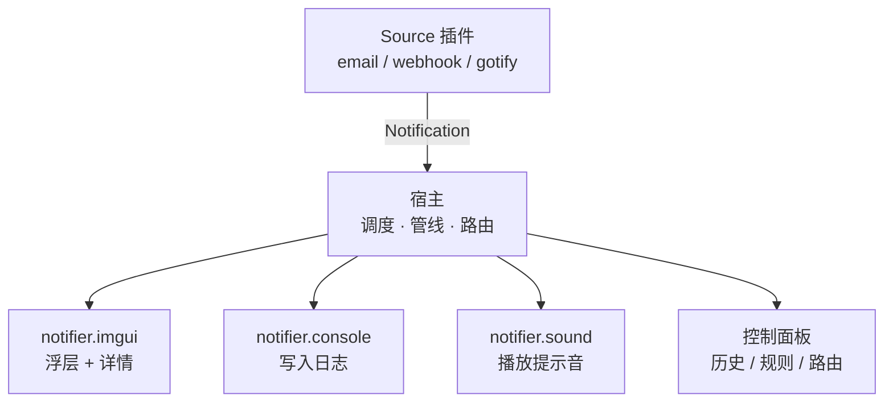

<p align="center">
  
</p>

<h1 align="center">SimpleMessage</h1>

<p align="center"><strong>基于插件机制的通知聚合与投递工具</strong></p>

<div align="center">
  
  
  
  
</div>

> [!NOTE]
> SimpleMessage 目前以 **Windows x64** 为主要目标平台（Windows 7 SP1 为最佳努力兼容）。宿主常驻系统托盘，界面由 Dear ImGui 绘制，配置使用 TOML。

## 目录

- [简介](#简介)
- [特性](#特性)
- [工作原理](#工作原理)
- [快速开始](#快速开始)
  - [环境要求](#环境要求)
  - [构建](#构建)
  - [运行](#运行)
- [使用](#使用)
  - [命令行](#命令行)
  - [配置文件](#配置文件)
  - [控制面板](#控制面板)
- [插件开发](#插件开发)
  - [最小插件示例](#最小插件示例)
  - [SDK 速览](#sdk-速览)
  - [示例插件](#示例插件)
  - [C# 与 Native AOT](#c-与-native-aot)
- [项目结构](#项目结构)
- [构建选项](#构建选项)
- [测试](#测试)
- [文档](#文档)
- [贡献](#贡献)
- [许可证](#许可证)
- [第三方依赖](#第三方依赖)

---

## 简介

SimpleMessage 是一个常驻托盘的 Windows 通知聚合与投递工具。数据由**调度源插件（Source）**采集，经宿主的调度、路由与队列，交给 **UI 插件（Notifier）**呈现或转发。

界面用 Dear ImGui 实现，配置用 TOML，日志自实现。

- **Source 插件**由调度线程驱动：宿主隔一段时间调用一次 `start()`，插件返回 0..N 条通知并注册下一次调度。
- **Notifier 插件**由通知投递驱动：宿主把匹配其订阅的通知交给它，由它决定怎么呈现。
- 两类插件继承同一个基类，加载、版本校验、隔离、启停、异常处理走完全相同的代码路径。

## 特性

- **插件化架构**：Source / Notifier 两类插件，DLL 导出四个符号；ABI 版本与宿主版本范围在加载时校验。
- **失败可见**：插件被拒绝加载、崩溃或超时时，日志、控制面板与统计三处都会留下痕迹，不静默跳过。
- **多实例**：Source 类型可在控制面板中自由添加实例，每个实例拥有独立设置文件、调度槽位与运行状态。
- **运行时重扫**：控制面板提供「重新扫描插件目录」，新出现的 DLL 会先校验再加载，无需重启宿主（替换正在使用的 DLL 仍需先禁用或重启）。
- **调度与隔离**：看门狗、退避、连续失败自动禁用、SEH 崩溃屏障。
- **通知呈现**：imgui 浮层、插件详情窗口、内存历史、异步图标加载；浮层可设常驻（`toast_duration_sec = 0`）。
- **路由与规则**：基于 topic 订阅、`config.toml [routing]` 覆盖、`rules.toml` 匹配 / 重写 / 丢弃 / 保存。
- **可移植渲染**：DX11 优先，OpenGL 回退，可用 `--renderer` 指定。
- **可测试**：ctest 单元测试 + 30 个用于验证加载器与隔离的坏插件。

## 工作原理



一次通知的旅程：

1. **采集**：调度线程调用 Source 插件的 `start()`，插件通过宿主 arena 分配并返回通知数组。
2. **入队**：宿主校验字段、补全 `summary`、分配单调递增的 `seq`，写入通知管线。
3. **路由**：按 topic 订阅与 `config.toml [routing]` 决定投递给哪些 Notifier 实例；`rules.toml` 可在途中重写或丢弃。
4. **呈现**：Notifier 在主线程收到 `on_notify()`；需要 UI 的插件先 `request_ui_surface()`，随后每帧绘制。
5. **动作**：用户点击 Action 后，宿主异步回调插件的 `on_action()`，并把通知标为已读。

所有跨插件边界的调用都有 SEH 屏障与超时约束；插件在错误线程调用方法属于未定义行为。

## 快速开始

### 环境要求

- Windows 10 / 11 x64（Windows 7 SP1 需开启 `SM_WIN7_COMPAT`）
- Visual Studio 2022，安装「使用 C++ 的桌面开发」工作负载
- CMake ≥ 3.20
- Git（版本号由 `git describe` 推导）

### 构建

```sh
git clone <repo> SimpleMesssage
cd SimpleMesssage
git fetch --tags
cmake -B build
cmake --build build --config Release --parallel
```

产物位于 `build/Release/`：

```text
sm_host.exe
sm_imgui.dll
sm_curl.dll
plugins/
  notifier.console.dll
  notifier.imgui.dll
  notifier.sound.dll
  source.email.dll
  source.gotify.dll
  source.webhook.dll
```

### 运行

```sh
build/Release/sm_host.exe          # 常驻托盘
build/Release/sm_host.exe --help   # 查看全部命令行参数
```

首次运行会在配置目录生成 `config.toml`、`rules.toml` 与插件设置文件。日志写到数据目录的 `logs/` 下。

## 使用

### 命令行

| 参数 | 说明 |
|---|---|
| `--config-dir <路径>` | 覆盖配置目录（默认 `<exe>\config`，不可写时回退 `%APPDATA%\SimpleMessage\config`） |
| `--data-dir <路径>` | 覆盖数据目录（日志与界面状态） |
| `--plugin-dir <路径>` | 覆盖插件目录（默认 `<exe>\plugins`） |
| `--console` | 跟随父进程的控制台，日志同时输出到标准输出 |
| `--safe-mode` | 不加载任何插件、不写回配置，直接打开控制面板 |
| `--renderer <名称>` | 渲染后端：`auto`（默认，优先 DX11）、`dx11`、`opengl` |
| `--help`, `-h` | 显示帮助后退出 |
| `--version` | 显示版本后退出 |

未知参数只会打印一行提示，不会拒绝启动。

> [!TIP]
> 插件导致宿主异常时，用 `--safe-mode --console` 启动：不加载插件、不写配置，并把日志打到标准输出。

### 配置文件

配置目录的确定顺序：

1. 命令行 `--config-dir`
2. `<exe 所在目录>/config/`（可创建且可写时）
3. `%APPDATA%\SimpleMessage\config\`

目录布局：

```text
<配置目录>/
├── config.toml              # 宿主配置：应用行为、插件实例、规则启用状态、路由覆盖
├── rules.toml               # 通知规则：匹配、重写、丢弃（只由用户手工编辑）
└── plugins/
    ├── source.email.toml    # 插件设置，文件名 = 实例 id
    └── notifier.imgui.toml
```

最小 `config.toml` 示例：

```toml
schema_version = 2

[app]
log_level = "info"
notify_log_level = "error"
log_retention_days = 7
ui_font_size = 16
notification_history_size = 200

[[instances]]
id = "notifier.imgui"
plugin = "notifier.imgui"
enabled = true
```

| 键 | 类型 | 默认 | 说明 |
|---|---|---|---|
| `app.notify_log_level` | string | `"error"` | 由日志转成通知的最低级别（`off` / `error` / `warn` / `info`） |
| `app.log_level` | string | `"info"` | 写入日志文件的最低级别 |
| `app.log_retention_days` | integer | `7` | 日志保留天数（1–365） |
| `app.log_max_total_mb` | integer | `32` | 日志总大小上限（1–1024 MB） |
| `app.ui_font_size` | integer | `16` | imgui 字号（10–32 像素） |
| `app.single_instance` | boolean | `true` | 单实例保护 |
| `app.notification_history_size` | integer | `200` | 内存历史条数上限（硬上限 200） |
| `app.allow_rule_save` | boolean | `false` | 允许带 `save` 的规则把通知写入文件 |

`[[instances]]` 描述插件实例：

| 键 | 必填 | 说明 |
|---|---|---|
| `id` | 是 | 实例 id，由宿主生成，不可手工改名 |
| `plugin` | 是 | 插件类型 id（`PluginMeta::id`），即 DLL 文件名 |
| `name` | 否 | 界面显示名，空表示自动命名 |
| `enabled` | 否 | 是否加载，默认 `true` |

> [!NOTE]
> 本仓库**不附带** `config/` 样例目录。宿主首次运行时会按默认值与插件 schema 自动生成配置文件；`rules.toml` 仅在缺失时生成默认模板，之后宿主不会写回。

`config.toml` 的 `schema_version` 当前为 **2**，插件设置文件为 **1**；文件版本高于宿主时宿主拒绝启动，避免把新语义写坏。

### 控制面板

单击托盘图标打开控制面板，共七个页面：

| 页面 | 内容 |
|---|---|
| **概览** | 运行状态、插件与通知统计 |
| **插件** | 实例列表、启用/禁用、添加/删除实例、自动生成的设置表单、重新扫描插件目录 |
| **通知** | 历史列表、过滤、详情、Action、清空 |
| **规则** | `rules.toml` 中的规则列表与详情，支持重新加载 |
| **路由** | 当前生效的 topic → Notifier 路由 |
| **日志** | 运行日志查看 |
| **关于** | 版本、依赖与许可信息 |

关闭面板后程序继续在托盘中运行；每个插件的详情视图是独立窗口。

## 插件开发

插件是一个 DLL，导出四个符号：

| 符号 | 作用 |
|---|---|
| `sm_abi_version` | 返回编译期 `SM_API_VERSION` |
| `sm_plugin_meta` | 返回静态 `PluginMeta` |
| `sm_create_plugin` | 创建插件实例 |
| `sm_destroy_plugin` | 销毁插件实例 |

不要手写这四个符号，在全局作用域用一次宏：

```cpp
SM_DEFINE_PLUGIN(kMeta, Example);
```

### 最小插件示例

```cpp
#include "sm/export.h"
#include "sm/plugin.h"

namespace {

constexpr sm::PluginMeta kMeta = {
    /* id          */ "source.example",
    /* name        */ "示例源",
    /* author      */ "……",
    /* version     */ "1.0.0",
    /* description */ "每隔 60 秒产生一条通知。",
    /* kind        */ sm::PluginKind::Source,
    /* host_range  */ ">=0.1.0,<1.0.0",
    /* subs        */ sm::Span<const char*>{},
    /* settings    */ sm::Span<const sm::SettingDef>{},
    /* api_version */ SM_API_VERSION,
};

class Example final : public sm::PluginBase {
 public:
  explicit Example(sm::IHostContext* host) : sm::PluginBase(host, kMeta) {}

  sm::StartResult start(sm::StartOutput* out) override {
    auto* items = host()->allocate_array<sm::Notification>(1);
    if (items == nullptr) return sm::StartResult::Error;

    items[0] = sm::Notification{};
    items[0].title = host()->allocate_string("你好", sm::limits::kMaxTitleBytes);
    items[0].topic = host()->allocate_string("example.tick", 64);
    items[0].time_unix_ms = host()->now_unix_ms();
    out->items = sm::Span<const sm::Notification>(items, 1);

    host()->schedule_next(60 * 1000);  // 不注册下一次，插件就休眠
    return sm::StartResult::Ok;
  }
};

}  // namespace

SM_DEFINE_PLUGIN(kMeta, Example);
```

硬规则：

- `start()` 不得阻塞、不得做没有超时的网络或磁盘 IO；长任务应放到插件自己的线程。
- 回调期间分配的内存绑定到本次调用的 arena；需要留存的字符串必须拷贝。
- `exit()` 返回前必须销毁自己创建的一切，包括 join 掉所有线程。
- `on_notify()` / `on_action()` 同样禁止阻塞。
- 使用 imgui 时必须用宿主随附的 `external/imgui` 同一版本编译，且禁止缓存上下文或字体指针。

### SDK 速览

| 类型 / 接口 | 说明 |
|---|---|
| `sm::PluginKind` | `Source` / `Notifier` |
| `sm::StartResult` | `Ok` / `Empty` / `Error` / `Abort` / `Cancelled` |
| `sm::Notification` | `title` / `content` / `summary` / `topic` / `level` / `time_unix_ms` / `id` / `url` / `icon` / `actions` / `source_plugin` / `seq` |
| `sm::Level` | `Debug` / `Info` / `Warning` / `Error` / `Critical` |
| `sm::PluginMeta` | 插件 id、版本、类别、宿主版本范围、订阅、设置 schema、API 版本 |
| `sm::SettingDef` | 设置项 schema；用 `sm::setting::boolean/integer/number/text/enumeration/sound` 构造 |
| `sm::IHostContext` | 版本与目录、arena 分配、调度、读写设置、日志、取消、imgui、图标、Action、打开 URL、主线程任务 |
| `sm::limits` | 标题 256 B、正文 64 KiB、topic 128 B、每条通知最多 4 个 Action、历史上限 200 等 |

完整的逐符号参考见 [插件开发/02-SDK接口参考.md](docs/插件开发/02-SDK接口参考.md)。

### 示例插件

| 插件 | 类型 | 用途 |
|---|---|---|
| `source.email` | Source | libcurl 直连 IMAP/IMAPS 轮询邮箱，把新邮件变成通知 |
| `source.webhook` | Source | cpp-httplib 起接收端口，把 HTTP 请求变成通知 |
| `source.gotify` | Source | 连接 Gotify 的 WebSocket 流，把推送消息变成通知 |
| `notifier.imgui` | Notifier | 通知浮层 + 详情视图，展示 `request_ui_surface` / `invoke_action` |
| `notifier.console` | Notifier | 把通知写进日志，最小可用 Notifier（无 UI） |
| `notifier.sound` | Notifier | 按通知级别播放 WAV / MP3，可调音量 |

`notifier.imgui` 的常用设置：`toast_duration_sec`（0–120，**0 表示常驻不自动消失**）、`max_toasts`、`toast_width_min` / `toast_width_max`、`show_actions`。

### C# 与 Native AOT

`plugins/source.csharp/` 是一个用 C# 编写的 Source 插件示例，演示如何在托管代码中手工同步 ABI。它**不**接入 `plugins/CMakeLists.txt`：

```bat
dotnet publish -c Release -r win-x64
```

需要 .NET 10 SDK；Native AOT 链接阶段还需要带 C++ 工具（`link.exe`）的 Visual Studio。把生成的 `source.csharp.dll` 放进宿主 `plugins/` 目录即可。细节见 [plugins/source.csharp/README.md](plugins/source.csharp/README.md)。

## 项目结构

| 目录 | 内容 |
|---|---|
| `include/sm/` | SDK 公共头。插件作者唯一需要的东西（**接口已冻结**） |
| `src/platform/` | 平台层：窗口、文件、系统、控制台、对话框、图片、托盘、入口等抽象 + Win32 实现 |
| `src/host/` | 宿主实现：日志、配置、插件管理、调度器、通知管线、路由、规则、UI、控制面板 |
| `plugins/` | 六个 C++ 示例插件；`source.csharp` 为独立 .NET 示例；`_test` / `_badmeta` 为坏插件 |
| `tests/` | SDK 与宿主纯函数单元测试 |
| `scripts/` | 开机自启的注册/撤销脚本（Windows / Linux） |
| `external/` | 第三方依赖源码与构建脚本 |
| `docs/` | 架构文档 3 篇 + 插件开发文档 4 篇 |

## 构建选项

| 选项 | 默认 | 说明 |
|---|---|---|
| `SM_BUILD_HOST` | ON | 构建宿主可执行文件 |
| `SM_BUILD_SAMPLES` | ON | 构建六个 C++ 示例插件 |
| `SM_BUILD_TEST_PLUGINS` | OFF | 构建 `plugins/_test/` 与 `plugins/_badmeta/` 的坏插件到 `plugins_test/` |
| `SM_BUILD_TESTS` | ON | 构建单元测试 |
| `SM_WIN7_COMPAT` | OFF | Windows 7 SP1 最佳努力配置 |
| `SM_EMBED_CJK_FONT` | OFF | 内嵌中文字体而非从系统加载 |
| `SM_WARNINGS_AS_ERRORS` | ON | 把编译警告当作错误 |

## 测试

```sh
cmake -B build -DSM_BUILD_TESTS=ON
cmake --build build --config Release --parallel
ctest --test-dir build -C Release --output-on-failure
```

测试目标：

| 目标 | 覆盖 |
|---|---|
| `sm_sdk_tests` | 版本范围解析、摘要生成等 SDK 纯函数 |
| `sm_host_rules_tests` | 规则匹配与占位符 |
| `sm_host_instances_tests` | 插件实例配置与迁移 |

需要验证加载器对坏插件的处理时：

```sh
cmake -B build -DSM_BUILD_TEST_PLUGINS=ON
```

坏插件会输出到 `build/Release/plugins_test/`，覆盖崩溃、挂起、超时、错误元信息、重复调度等场景。

CI（`.github/workflows/ci.yml`）在 Windows x64 上构建、运行 ctest、检查产物齐全性并打包；另有一条 Windows 7 兼容流水线。

## 文档

| 文档 | 内容 |
|---|---|
| [docs/README.md](docs/README.md) | 文档索引 |
| [架构总览](docs/01-架构总览.md) | 术语表、通知旅程、进程与线程、调度循环、UI 会话、安全模型 |
| [宿主设计](docs/02-宿主设计.md) | 插件管理器、异常隔离、调度器、通知管线、路由、日志、配置 |
| [控制面板](docs/03-控制面板.md) | 七个页面各自显示什么、怎么交互 |
| [插件开发入门](docs/插件开发/01-入门.md) | 最小插件、四个导出符号、加载校验、线程与内存规则 |
| [SDK 接口参考](docs/插件开发/02-SDK接口参考.md) | 逐符号 API 参考 |
| [配置格式](docs/插件开发/03-配置格式.md) | `config.toml`、`rules.toml`、插件设置文件的全部键 |
| [示例插件](docs/插件开发/04-示例插件.md) | 六个示例插件的设置项与设计要点 |

## 贡献

1. 从 `main` 切出功能分支，提交 Pull Request。
2. 构建时保持 `SM_WARNINGS_AS_ERRORS=ON`，并运行 `ctest`。
3. SDK 接口已冻结：修改 `include/sm/` 的公开布局必须递增 `SM_API_VERSION`，并同步更新文档与 C# 示例的 ABI 层。
4. 新增行为请补充对应文档（`docs/`）与测试。

## 许可证

本项目采用 **MIT License**。

完整许可全文见 [LICENSE](LICENSE)。第三方组件各自适用其原始许可证，详见下一节。

## 第三方依赖

| 依赖 | 版本 | 许可证 | 使用方 |
|---|---|---|---|
| **Dear ImGui** | v1.93.0 | MIT | 宿主、`notifier.imgui`（共享库 `sm_imgui.dll`） |
| **toml++** | v3.4.0 | MIT | 宿主配置解析 |
| **GLFW** | v3.5.1 | Zlib/libpng | 宿主窗口层 |
| **libcurl** | 8.23.1-DEV | curl | 宿主图标下载、`source.email`、`source.gotify`（共享库 `sm_curl.dll`） |
| **cpp-httplib** | v0.61.0 | MIT | `source.webhook` |
| **miniaudio** | v0.11.25 | MIT | 宿主与 `notifier.sound` |

各许可证全文见 [THIRD-PARTY-NOTICES.txt](THIRD-PARTY-NOTICES.txt)，版本锁定与来源见 `external/PROVENANCE.txt`。
